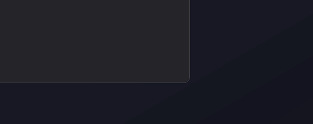
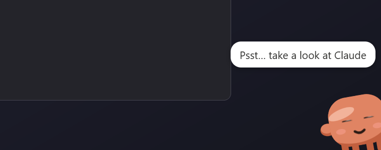
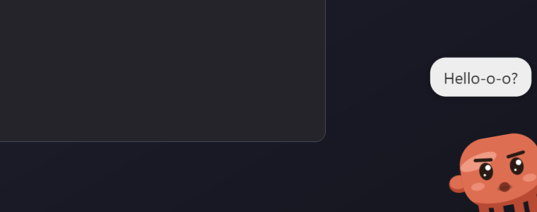
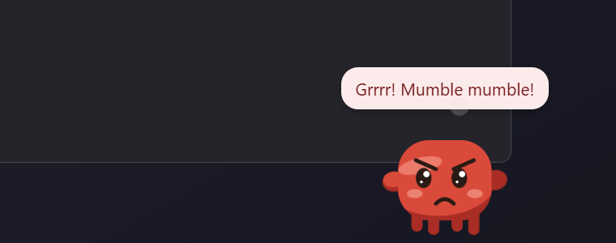
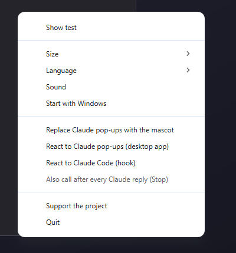

<p align="center">
  <a href="https://dalink.to/olegche"></a>
</p>

<h1 align="center">Mascot</h1>

<p align="center">
  <b>A little orange guy who nudges you when Claude is waiting for your answer.</b><br>
  <a href="README.ru.md">Русский</a> · <b>English</b>
</p>

<p align="center">
  <a href="https://github.com/OlegChe77/claude-mascot/releases/latest"></a>
  <a href="https://github.com/OlegChe77/claude-mascot/releases"></a>
  <a href="LICENSE"></a>
  <a href="#download"></a>
  <a href="#auto-update"></a>
</p>

<p align="center">
  
</p>

A little orange mascot for Windows that peeks out of the bottom-right corner of the screen when Claude (Claude Code or the Claude desktop app) is waiting for you — and the Claude window is minimized or in the background. No more forgotten permission prompts.

## Download

**[⬇ Latest release](https://github.com/OlegChe77/claude-mascot/releases/latest)**

- `Mascot-Setup-<version>.exe` — installer. **Updates itself.**
- `Mascot-<version>-portable.exe` — a single file, no installation. Tells you when a new version is out.

## How it behaves

1. **Peeks out** of the bottom-right corner three times and says a few phrases each time. The third time it is already grumpy.
2. **Gets angry.** Then it comes out completely for 20 seconds: turns red, stomps along the bottom of the screen, shakes its fists and grumbles.
3. **Repeats** until you respond. Switch to Claude or click the mascot — it runs away at once (a click also brings up the Claude window).

It lives in the tray, does not steal focus, and clicks pass through everything except the mascot itself. English and Russian: the language follows Windows and can be changed in the tray menu.

|                       Peeks out                        |                        Gets grumpy                         |
| :----------------------------------------------------: | :--------------------------------------------------------: |
|  |  |

|                       Angry                       |                  Tray menu                  |
| :-----------------------------------------------: | :-----------------------------------------: |
|  |  |

<p align="center">
  
</p>

## Auto-update

Mascot checks GitHub Releases 15 seconds after start and then every 6 hours. You can turn it off with **Update automatically** in the tray menu, or check by hand with **Check for updates**.

- **Installer** (`Mascot-Setup-….exe`) — **updates itself.** A new version is downloaded in the background and installed the next time Mascot restarts (or right away via **Restart and update** in the tray menu). You do nothing.
- **Portable** (`Mascot-….-portable.exe`) — cannot replace its own file, so it only **tells you** that a new version is out (a tray notification) and opens the download page on **Download** in the tray menu.

## How it knows Claude is waiting

- **Claude Code hooks.** On start the mascot adds hooks (`Notification`, `PermissionRequest`, `PreToolUse` for `AskUserQuestion|ExitPlanMode`, optionally `Stop`) to `~/.claude/settings.json`, with a backup. The hook command is `curl … http://127.0.0.1:47821/hook || exit 0` — if the mascot is not running, it silently does nothing.
- **Claude desktop pop-ups.** New Claude notifications in the Windows notification database also call the mascot.
- **“Replace Claude pop-ups with the mascot”** (on by default) turns off Claude's notification banners; notifications stay in the Action Center. Turning the option off or quitting restores the previous setting.

## Tray menu

Show test · Size · Language · Sound · Start with Windows · Replace Claude pop-ups with the mascot · React to Claude pop-ups · React to Claude Code (hook) · Also call after every reply (Stop) · Check for updates · Update automatically · Support the project · Quit

## Build from source

```bash
npm install
npm start
npm run dist
```

`npm run dist` builds the installer and the portable exe into `dist/`.

Release: bump `version` in `package.json`, push a tag `v<version>` — GitHub Actions builds and publishes the release, and installed copies update themselves.

## Support the project

If the mascot made your day a little better, you can say thanks:

<p align="center">
  <a href="https://dalink.to/olegche"></a>
</p>

## License

[MIT](LICENSE)
