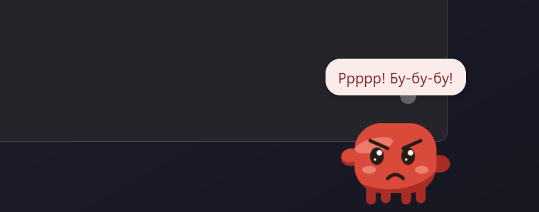
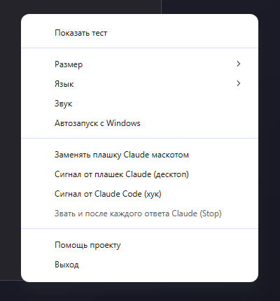

<p align="center">
  <a href="https://dalink.to/olegche"></a>
</p>

<h1 align="center">Маскот</h1>

<p align="center">
  <b>Маленький оранжевый помощник, который напомнит, что Claude ждёт вашего ответа.</b><br>
  <b>Русский</b> · <a href="README.md">English</a>
</p>

<p align="center">
  <a href="https://github.com/OlegChe77/claude-mascot/releases/latest"></a>
  <a href="https://github.com/OlegChe77/claude-mascot/releases"></a>
  <a href="LICENSE"></a>
  <a href="#скачать"></a>
  <a href="#автообновление"></a>
</p>

<p align="center">
  
</p>

Маленький оранжевый маскот для Windows: выглядывает из правого нижнего угла экрана, когда Claude (Claude Code или десктопное приложение) ждёт вашего ответа, а окно Claude свёрнуто или не активно. Больше никаких забытых запросов разрешения.

## Скачать

**[⬇ Последний выпуск](https://github.com/OlegChe77/claude-mascot/releases/latest)**

- `Mascot-Setup-<версия>.exe` — установщик. **Обновляется сам.**
- `Mascot-<версия>-portable.exe` — один файл без установки. Сообщает о новой версии.

## Как он себя ведёт

1. **Выглядывает** из правого нижнего угла три раза, каждый раз говорит несколько фраз. На третий — уже недоволен.
2. **Злится.** Потом выходит целиком на 20 секунд: краснеет, топает по низу экрана, трясёт кулаками, ворчит.
3. **Повторяет**, пока вы не откликнетесь. Перейдите в Claude или нажмите на маскота — он сразу убежит (клик ещё и разворачивает окно Claude).

Живёт в трее, не забирает фокус, клики проходят сквозь всё, кроме самого маскота. Русский и английский: язык — как в Windows, меняется в меню трея.

|                      Выглядывает                       |                      Недоволен                       |
| :----------------------------------------------------: | :--------------------------------------------------: |
|  |  |

|                        Злится                         |                 Меню трея                  |
| :---------------------------------------------------: | :----------------------------------------: |
|  |  |

<p align="center">
  
</p>

## Автообновление

Маскот проверяет GitHub Releases через 15 секунд после запуска и потом раз в 6 часов. Отключить можно пунктом трея **«Обновлять автоматически»**, проверить вручную — **«Проверить обновления»**.

- **Установщик** (`Mascot-Setup-….exe`) — **обновляется сам.** Новая версия скачивается в фоне и ставится при следующем перезапуске Маскота (или сразу — пунктом **«Перезапустить и обновить»** в меню трея). От вас ничего не требуется.
- **Portable** (`Mascot-….-portable.exe`) — не может заменить собственный файл, поэтому только **сообщает** о новой версии (уведомление из трея), а по пункту **«Скачать»** открывает страницу загрузки.

## Откуда он знает, что Claude ждёт

- **Хуки Claude Code.** При запуске маскот прописывает хуки (`Notification`, `PermissionRequest`, `PreToolUse` для `AskUserQuestion|ExitPlanMode`, по желанию `Stop`) в `~/.claude/settings.json`, с бэкапом. Команда хука — `curl … http://127.0.0.1:47821/hook || exit 0`: если маскот не запущен, она молча ничего не делает.
- **Плашки десктопного Claude.** Новые уведомления Claude в базе уведомлений Windows тоже зовут маскота.
- **«Заменять плашку Claude маскотом»** (по умолчанию вкл) выключает всплывающие баннеры Claude, записи в центре уведомлений остаются. Выключение пункта и выход возвращают прежнюю настройку.

## Сборка

```bash
npm install
npm start
npm run dist
```

`npm run dist` собирает установщик и portable-exe в `dist/`.

Выпуск: поднять `version` в `package.json`, отправить тег `v<версия>` — GitHub Actions соберёт и опубликует выпуск, установленные копии обновятся сами.

## Помощь проекту

Если маскот сделал ваш день чуть приятнее, можно сказать спасибо:

<p align="center">
  <a href="https://dalink.to/olegche"></a>
</p>

## Лицензия

[MIT](LICENSE)
